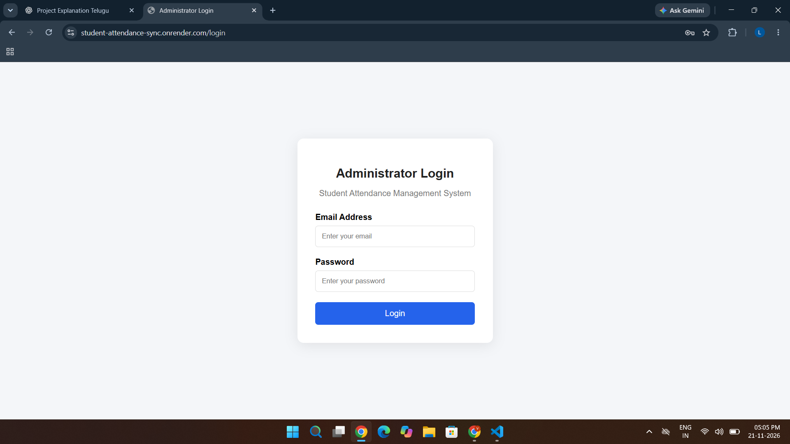
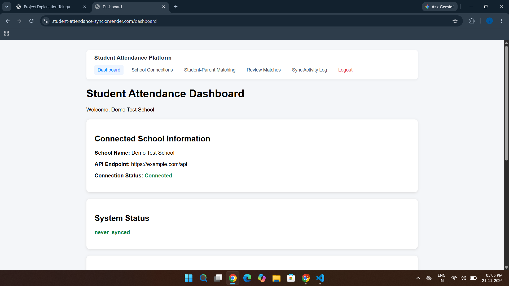
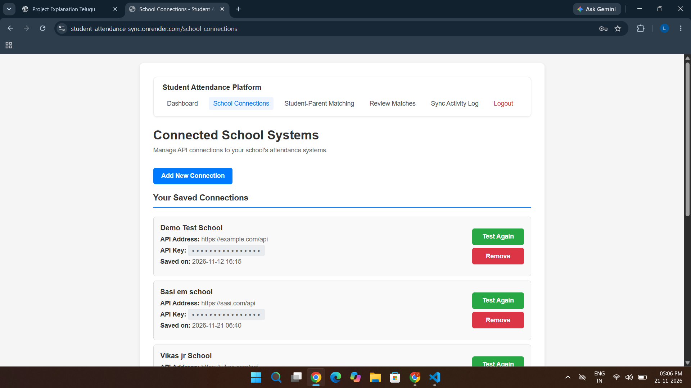
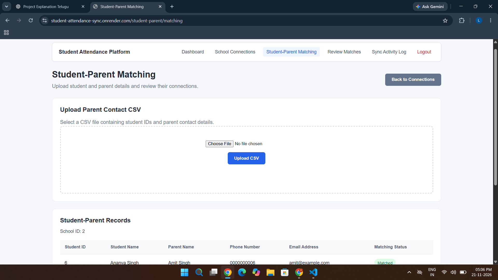
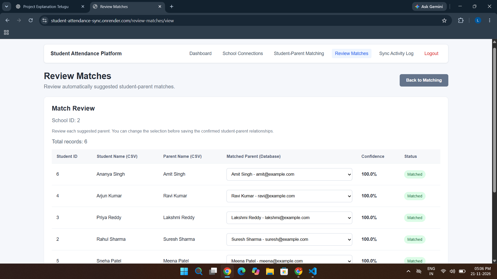
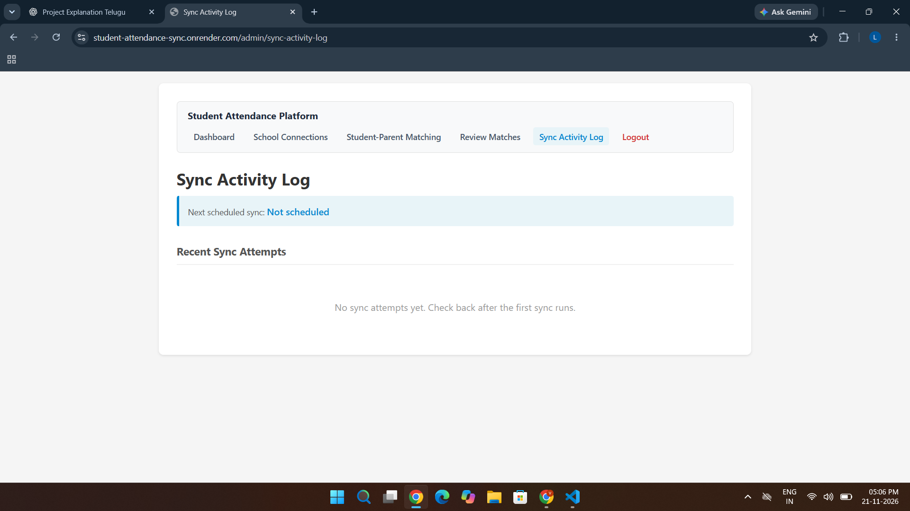

# Student Attendance Sync Platform

A web-based platform built using Python Flask and PostgreSQL to manage school connections and student-parent contact matching.

## Live Demo

**Live Application:** https://student-attendance-sync.onrender.com

**GitHub Repository:** https://github.com/likhithareddy4718/student-attendance-sync

## Problem Statement

Schools need an organized way to manage student information and associate students with their respective parent contact details. Managing these records manually can lead to duplicate entries and incorrect associations.

This project provides a centralized platform for managing school connections, uploading student-parent contact details, reviewing suggested matches, and saving confirmed relationships.

## Main Features

- Administrator login and authentication.
- Dashboard for viewing school information and synchronization activity.
- School connection management.
- CSV upload for student-parent contact information.
- Automated student-parent match suggestions.
- Match confidence display and manual review.
- Save confirmed student-parent relationships.
- Synchronization activity and error logs.

## Technology Stack

| Component | Technology |
|---|---|
| Frontend | HTML, CSS, JavaScript |
| Backend | Python, Flask |
| Database | PostgreSQL |
| Database access | SQLAlchemy, psycopg2 |
| Authentication | Flask sessions, bcrypt |
| Application server | Gunicorn |
| Deployment | Render |
| Version control | Git, GitHub |

## How It Works

1. The administrator logs into the application.
2. The administrator manages school connections.
3. Student and parent contact information is uploaded through a CSV file.
4. The application generates suggested student-parent matches.
5. The administrator reviews the suggested relationships.
6. Confirmed relationships are saved in PostgreSQL.

## Screenshots

Add screenshots of these application pages:

### Login Page

### Dashboard

### School Connections

### Student-Parent Matching

### Review Matches

### Sync Activity Log

## A Challenging Problem I Solved

One of the major challenges I faced was deploying the application with a production PostgreSQL database.

The application worked locally, but after deployment, login and dashboard operations failed because some database tables were missing in the production database.

I investigated the Render application logs, identified the missing tables, inspected the existing database schema, and created the required tables without deleting existing records.

I also resolved authentication issues by configuring administrator password hashing with bcrypt and validating the login process.

This experience helped me understand production debugging, PostgreSQL database management, environment configuration, and cloud deployment.

## Deployment

The Flask application is hosted on Render using Gunicorn as the application server. The source code is maintained in GitHub, and the Render web service is connected to the repository for deployment.

PostgreSQL is used as the production database.

## Security

- Sensitive configuration is managed using environment variables.
- Database credentials and secret keys are not hardcoded in source code.
- Passwords are stored as bcrypt hashes.
- Private student-parent contact data should not be committed to GitHub.

## Future Improvements

- Integrate a real school's attendance API.
- Implement scheduled automatic attendance synchronization.
- Add database migrations using Flask-Migrate or Alembic.
- Improve monitoring, reporting, and notification features.

## Author

Developed as a Student Attendance Synchronization project using Python Flask and PostgreSQL.

## Difficult problem section

One of the biggest challenges was deploying the application with PostgreSQL on Render. Initially, login and dashboard operations failed because some required database tables were missing. I investigated the server logs, identified the missing tables, and created them safely without deleting existing records. I also resolved password verification issues using bcrypt. This helped me understand production debugging and cloud database management.